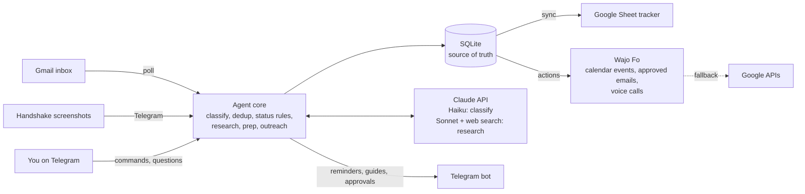

# Jobby

An always-on agent that keeps track of internship applications, so you don't have to.

Handshake and Interstride have no API, but every application sends email. Jobby watches your inbox, keeps one tracker row per application, puts interviews and deadlines on your calendar, sends you a prep guide when an interview is booked, and has Wajo's **Fo** phone you an hour before it starts. You talk to it on Telegram.

Built solo for the Wajo GSD Hackathon, October 2026.

## What it does

- **Imports past applications** from screenshots of your Handshake applications page (Claude vision), after you confirm the list.
- **Reads your inbox** every few minutes and classifies application emails: confirmations, assessments, interview invites, reschedules, rejections, offers, recruiter messages.
- **Keeps one row per application** in a Google Sheet. Fuzzy matching on company and role prevents duplicates, and statuses only move forward, except for rejections and offers.
- **Puts interviews and deadlines on your calendar** through Fo, and moves the same event when an interview is rescheduled.
- **Sends a prep guide** on Telegram when an interview is booked. It covers company research from the web with sources, likely questions with tips based on your own projects, questions to ask, and logistics.
- **Reminds you** 24 hours and 2 hours before each event, and sends a digest of your week every morning.
- **Fo calls your phone** an hour before an interview with three things to remember. If the call fails, the same summary arrives on Telegram.
- **Suggests short outreach emails** where they would help. Nothing is sent until you tap **Approve** in Telegram, and Fo then sends the email from your own address.
- **Answers questions** like "what do I have this week?" from what it knows.

## Demo (about 2 minutes)

1. `/import`, then send Handshake screenshots. Jobby replies "Imported N applications" and the sheet fills up.
2. An interview invite arrives (or send yourself a test one). Within a minute the row changes to Interview, the event appears on your calendar, and Telegram pings you.
3. The prep guide arrives. Ask "what do I have this week?"
4. `/outreach Company` drafts an email for an application with no reply. Tap **Approve** and Fo sends it.
5. `/call Company`: Fo phones you with "your interview is in an hour, here are 3 things to remember".

Before each run: `python main.py --demo-reset`. It resets the demo data, the sheet, and Jobby's calendar events, and keeps your settings.

## How it works



- **SQLite is the single source of truth.** The sheet, calendar, and Telegram are outputs synced from it, so if an outside service goes down, no data is lost.
- **Fo is the action layer.** Each request to Fo is fully specified: exact times with offsets, exact recipient and body. Jobby then **checks Fo's work against Google**, read-only. An event only counts if it exists at the right time, and an email only counts if it appears in Sent. Anything else falls back to the Google APIs directly, and both attempts are logged.
- **All Claude calls go through one module** (`llm.py`). In mock mode it returns canned answers, so everything else runs unchanged without an API key.

## Safety

- **No email without your approval.** Outreach is sent only after an Approve tap from your chat, enforced in code. The limits are 1 per application and 3 per week. While `OUTREACH_SEND_TO_SELF=true` (the default), approved emails go to your own address.
- **Contacts are never guessed.** Jobby writes only to a recruiter who emailed you, an address the company publishes (kept only with its source URL), or an address you give it.
- **Fo is limited by an allow-list.** It may only create and update events, send approved emails, and call *you*. It never makes purchases or calls anyone else.
- **Gmail access** is read-only plus send. Jobby never deletes or changes email.
- **The Telegram bot answers only your chat.** Secrets, the database, your profile, and prep guides are all git-ignored.

## Setup

Requires Python 3.11+.

```bash
pip install -r requirements.txt
cp .env.example .env              # then fill it in (see below)
cp profile.example.md profile.md  # your projects, used in prep guides and outreach
```

1. **Google:** create a Desktop OAuth client with the Gmail, Calendar, and Sheets APIs enabled, and save it as `credentials.json`. The first run opens the browser once and saves `token.json`.
2. **Telegram:** create a bot with @BotFather, put the token in `TELEGRAM_BOT_TOKEN`, start Jobby, and send `/start`. Then copy your chat ID into `TELEGRAM_ALLOWED_CHAT_ID`.
3. **Fo:** connect Google (Calendar and Gmail, with "send as me" on) in Wajo, then run `python fo_client.py login` once.
4. **Claude:** put a Console API key in `ANTHROPIC_API_KEY` and set `LLM_MODE=live`. Without a key, Jobby runs in mock mode.

```bash
python main.py                    # run the agent: bot, inbox polling, reminders, sync
python main.py --replay-fixtures  # run the sample emails through the pipeline, no Gmail needed
python main.py --demo-reset       # reset to the demo starting point
python -m pytest tests            # tests run in mock mode and spend no credits
```

## Telegram commands

| Command | What it does |
|---|---|
| `/start` | Registers your chat; the bot ignores every other chat |
| `/status` | Counts by status, open next steps, and the sheet link |
| `/upcoming` | Events in the next 7 days |
| `/check` | Checks the inbox now |
| `/import` | Imports applications from screenshots |
| `/add Company \| Role` | Adds an application |
| `/update Company status` | Changes a status, e.g. `/update Northwind rejected` |
| `/prep Company` | Writes (or rewrites) the interview prep guide |
| `/research Company` | Shows what Jobby knows about a company, with sources |
| `/outreach Company [email]` | Drafts an outreach email now; you still approve it |
| `/call Company` | Fo calls you now with a prep summary |
| free text | e.g. "which OAs are due this week?" |

## Project layout

| File | Role |
|---|---|
| `main.py` | Entry point: starts the bot and its jobs |
| `telegram_bot.py` | Commands, buttons, and the scheduled jobs (inbox, reminders, calls, digest, outreach) |
| `pipeline.py` | One email in, database updated (dedup, status rules, events) |
| `classifier.py`, `importer.py`, `research.py`, `prep.py`, `outreach.py`, `qa.py` | Claude-powered steps |
| `llm.py` | The only module that calls Claude; live and mock modes |
| `actions/` | `FoActions` (Wajo Fo over MCP) and `GoogleActions`, behind one allow-listed interface |
| `fo_client.py` | Jobby's own MCP connection and login to Fo |
| `trackers/sheets.py` | Google Sheets mirror |
| `gmail_watcher.py`, `calendar_sync.py`, `reminders.py`, `dedup.py`, `db.py` | The rest |
| `fixtures/` | Sample emails and mock answers, all fake companies |
